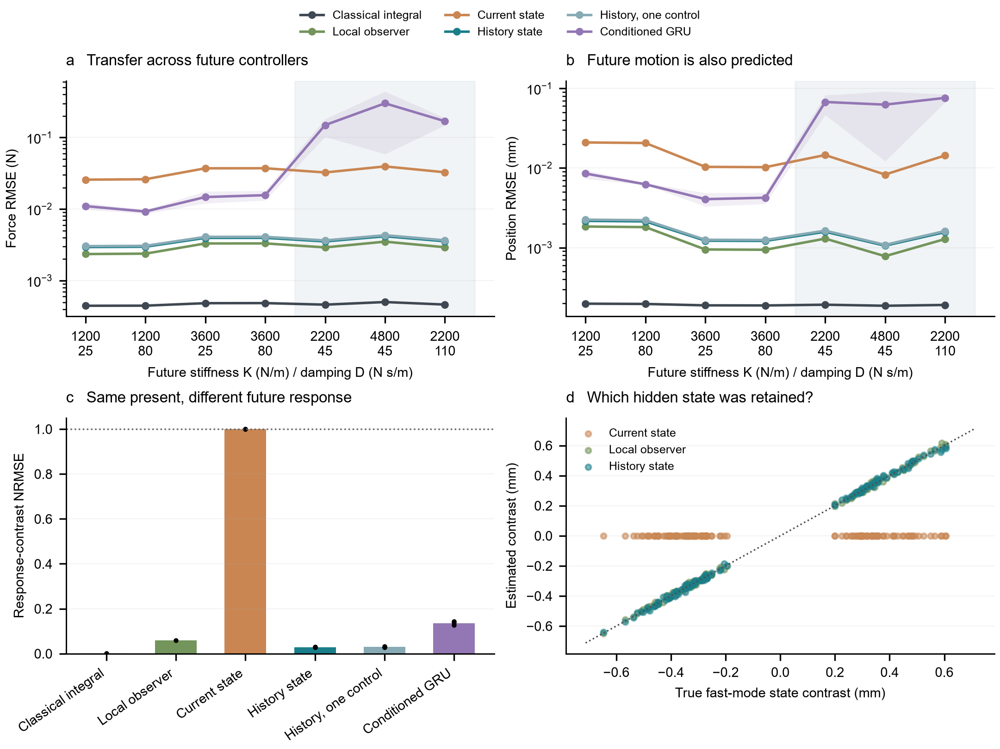
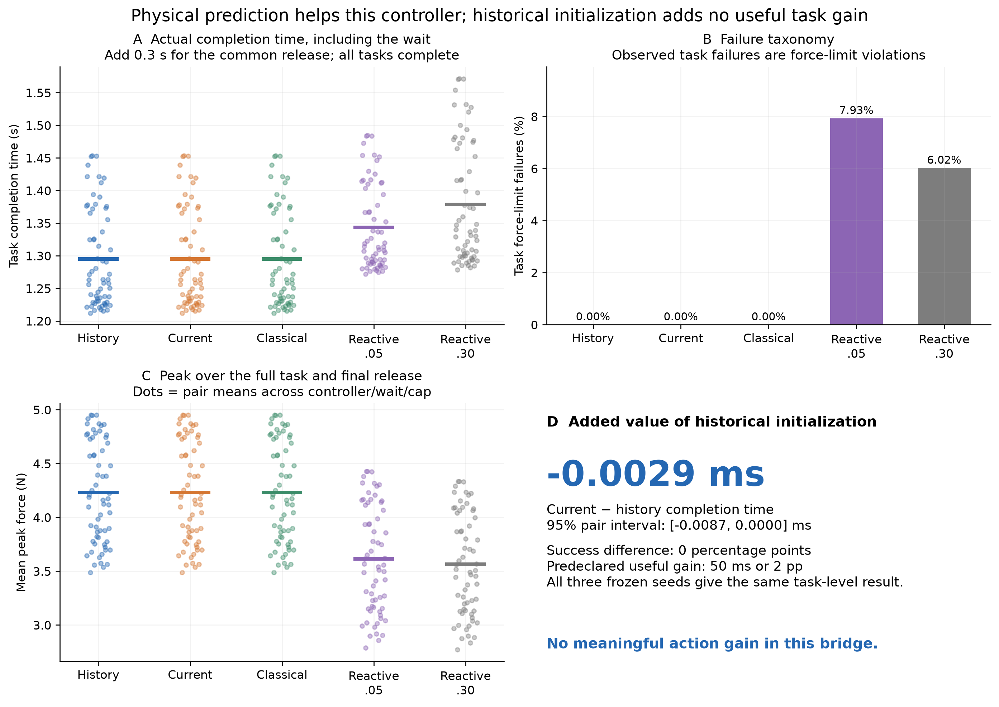

# Earlier contact experiments

Three recorded simulations examine whether loading history improves prediction and action. The material-collection folder contains a proposed real-data protocol.

| Experiment | Question | Main result |
| --- | --- | --- |
| [History dependence](experiments/history_dependence/) | Do different loading histories produce different futures despite matched current observations? | History helps prediction; a classical observer is more accurate in the tested setting |
| [Controller transfer](experiments/controller_transfer/v2/) | Can one state estimate be reused under different future controllers? | The estimate transfers in the recorded conditions |
| [Shared feedback](experiments/shared_feedback/) | Does history-based initialization still improve action when every method gets the same feedback? | No useful action benefit in this task |
| [Material collection](experiments/lab/) | How should synchronized measurements be collected and checked? | Protocol and synthetic interface checks; no real measurements yet |

[Results](RESULTS.md) · [Setup](SETUP.md) · [Reproduction](REPRODUCING.md)

## Experiment figures

### Loading history and recontact


The first test pair ends at the same measured position, velocity, force and command. The same future command produces different forces. The bottom panel compares how each estimator predicts that difference. [Run summary](experiments/history_dependence/runs/round2_v1/summary.json).

### Transfer to new controllers



Each history is encoded once and reused across future controllers. The shaded conditions were held out during training. Classical integration remains the most accurate method in this known-model setting. [Run summary](experiments/controller_transfer/v2/runs/transfer_v2/summary.json).

### Action under shared feedback



History and current-observation initializers yield almost identical task outcomes under the common observer and controller. These task metrics exclude the common 0.3 s initial release; its force-limit violations are reported separately. [Results](RESULTS.md#shared-feedback-shared-feedback-removes-the-useful-action-gain) · [Full operation and evaluation scope](experiments/shared_feedback/闭环衔接简报.md) · [Per-episode data](experiments/shared_feedback/results/episode_metrics.csv).

## Archive

- `experiments/`: original code, datasets, checkpoints and per-run results. Supporting `pilot/`, `controller/` and `acquisition/` folders retain earlier implementations.
- `presentation/` and `diagrams/`: progress slides and original research figures.
- `provenance/`: source hashes, layout mappings and compact local-workcopy snapshots.
- `tools/`: archive checks, bounded checkpoint replay and working-copy creation.

Experiment names describe the comparison. Original run identifiers inside raw records and slides are retained for traceability. [current_layout.json](provenance/current_layout.json) maps historical paths to this layout; the numerical archive is unchanged.

From the repository root:

```sh
python 1D/tools/verify_bundle.py
python 1D/tools/check_results.py
python 1D/tools/workcopy.py --experiment history-dependence --destination reproductions/history-dependence
```

The two checks use the Python standard library. Training and checkpoint replay use the separate environment described in [SETUP.md](SETUP.md).
