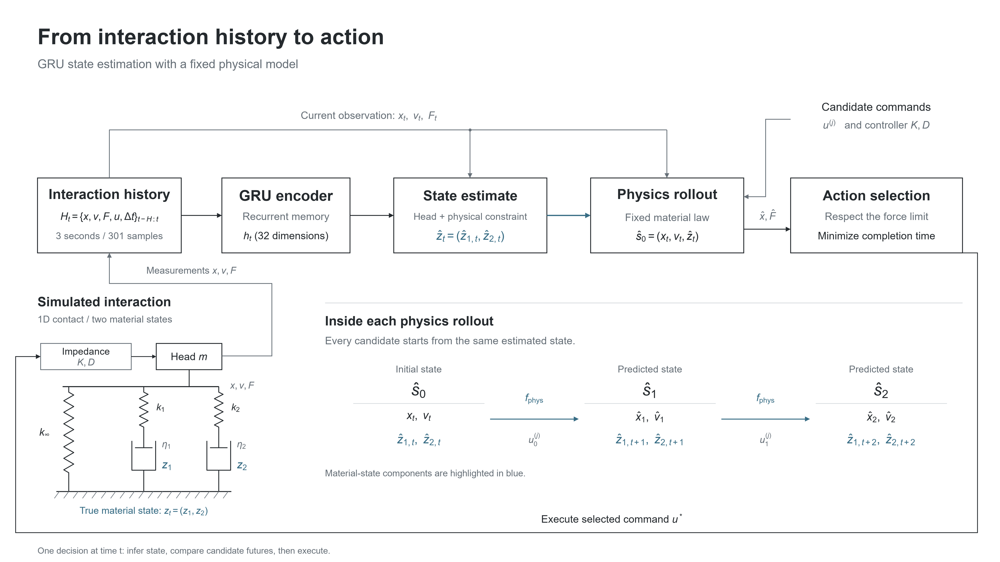

# Interaction history and material state

The drawing follows one decision in the E2 contact experiment. A GRU reads measured interaction history, estimates the material state, and passes that estimate to a fixed physics model. The model predicts the response to each candidate command; a shared selector chooses the fastest feasible candidate or rejects them all.

## Reading the diagram

The history contains 301 samples over three seconds. Each sample records measured position, velocity, force, commanded position and the time increment. The simulator's true internal state is used for evaluation, not as an encoder input.

A 32-unit GRU produces a hidden vector. A linear head and sigmoid allocate the branch stress between two estimated Maxwell states, with the current position and force constraining their weighted sum. The estimate and measured motion initialize the rollout. Candidate future commands and known controller gains enter the rollout separately.

The mechanical sketch has an equilibrium spring in parallel with two Maxwell branches. Each branch contains a spring and a viscous dashpot in series; the dashpot extensions are the two material variables. A gravity-compensated impedance controller moves the pressing head along one axis.

This is a schematic of a single decision. E3 separately tests what happens when every initialization receives common online feedback; its action result is reported in [RESULTS.md](../../RESULTS.md).

## Files and source

The [PNG](interaction_history_state_flow.png) is ready for slides. [SVG](interaction_history_state_flow.svg) retains editable text, and [PDF](interaction_history_state_flow.pdf) provides a vector export. [draw_state_flow.py](draw_state_flow.py) generates all three with Matplotlib. The drawing uses Arial on a 16 × 9 inch canvas; a different installed font can change the layout.

The implementation shown is in E2's [models.py](../../experiments/02_transfer/v2/models.py), [dynamics.py](../../experiments/02_transfer/v2/dynamics.py), [physics_base.py](../../experiments/02_transfer/v2/physics_base.py), [actions.py](../../experiments/02_transfer/v2/actions.py) and [config.json](../../experiments/02_transfer/v2/config.json). The diagram contains no measured results.
