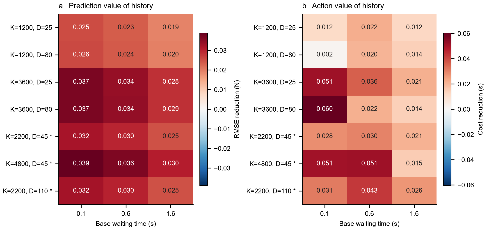
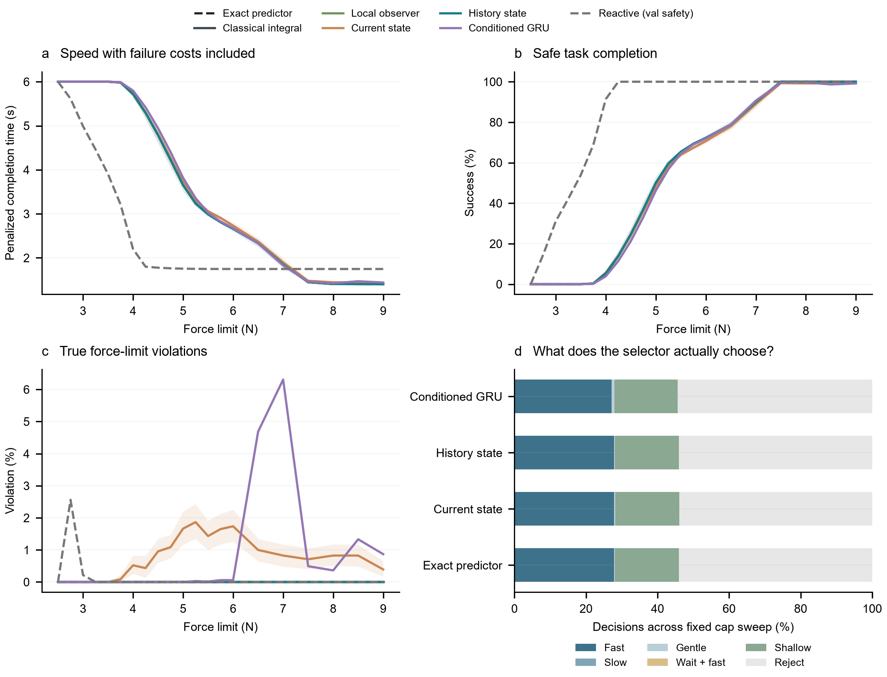
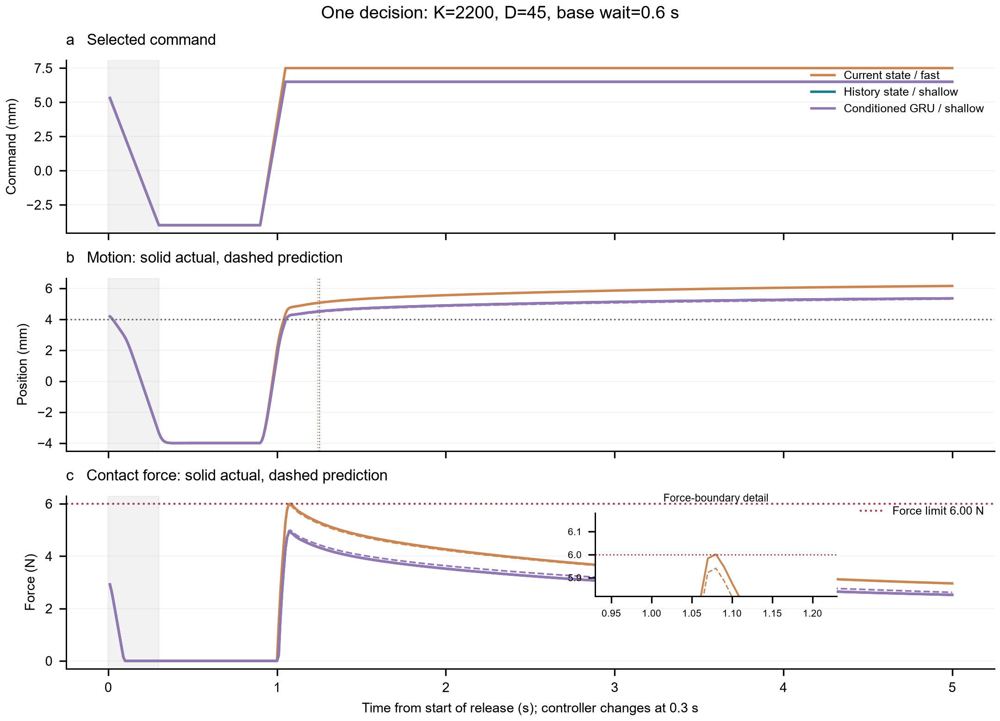
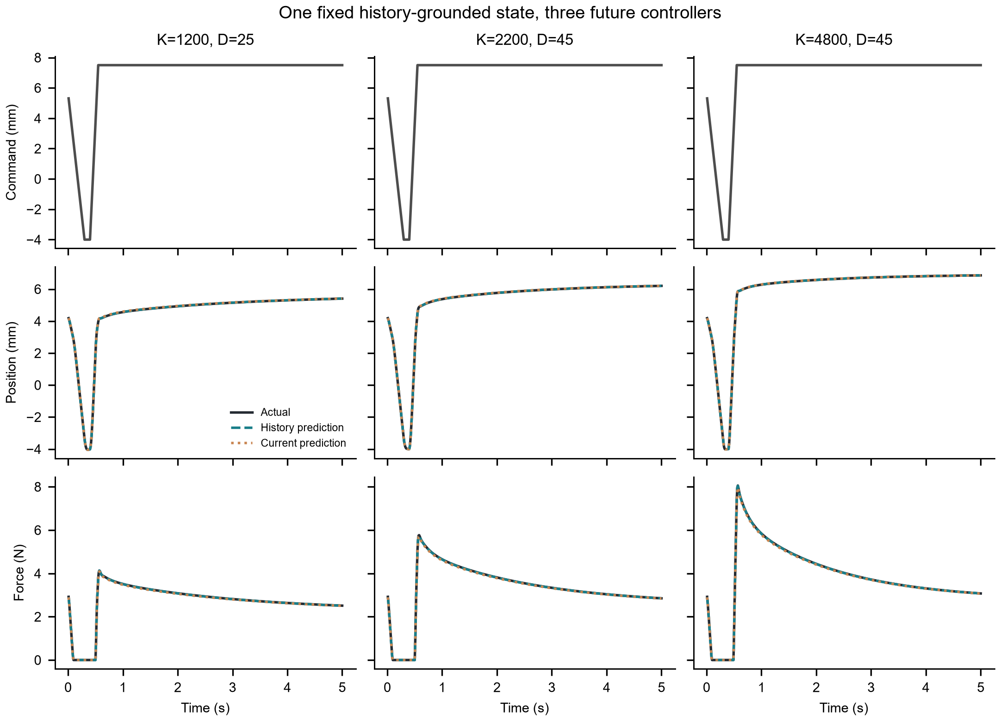
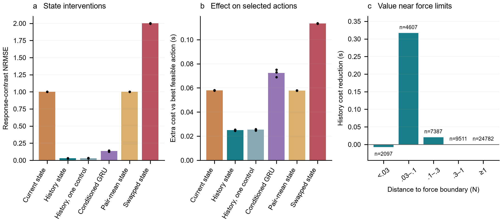
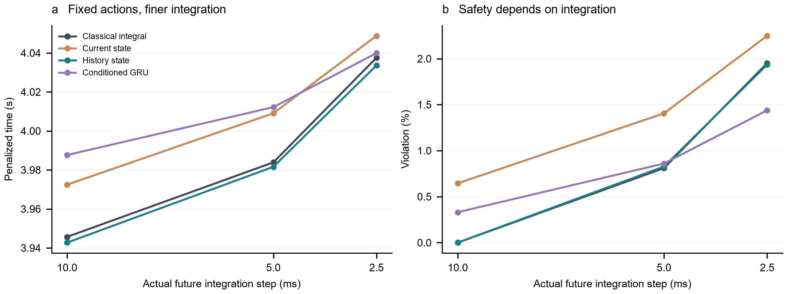

# 跨控制条件的物理状态迁移与动作选择：本轮结果

**建议继续这条主线，但目前最坚实的结论是“历史接地的物理状态能够迁移”，而不是“学习模型已带来显著的机器人任务优势”。** 已知材料规律下，历史状态在新控制条件中保持准确，确实改变少量动作决策；经典估计仍然很强，单控制条件训练几乎同样有效，动作收益又明显受候选动作、力阈值和积分误差影响。下一步更值得投入真实材料中可重复的未知恢复机制，而不是继续扩大这个已知 Maxwell 系统的网络。

本轮在 5070 Ti 上完成两套独立实验，共 24 个模型—种子训练。先导版本保留在本目录；主要隔离实验与全部可复现代码位于 [v2/README.md](v2/README.md)。所有结果来自实际执行的合成仿真，无实机数据。

## 1. 实际实现了什么

**High-level idea：** 当前位移、速度、力相同，不代表材料具有相同的恢复状态。我们从过去交互中确定内部应力如何分配到快、慢模态，保持这个状态穿过脱离，再与新的已知控制器和候选命令组合，预测实际运动与力。

**数据与场景：** 新生成 384 个训练历史对、96 个验证历史对、128 个测试历史对。每对都从松弛状态真实重放两段不同命令历史，在决策起点得到相同当前观测、不同内部状态；不是直接拼接隐藏状态。过去传感器噪声为位置 5 μm、速度 50 μm/s、力 0.02 N，配对末端共享噪声以保持当前输入一致。每个训练历史有四个未来分支，共 3072 条训练轨迹。历史所在控制器固定，因此本轮证明的是**未来控制器变化后的复用**，尚未证明历史采集控制器也任意变化时的编码泛化。

主要实验先用原控制器回撤 0.3 s，确认全部测试分支均已脱离，再切换未来控制条件，等待并重接触。模型每段历史只编码一次，状态广播到所有未来条件和动作；测试不更新参数。未来真实力和位置只作为标签或评价真值。

| 用途 | 刚度 K（N/m）、阻尼 D（Ns/m） |
|---|---|
| 训练与验证 | (1200,25)、(1200,80)、(3600,25)、(3600,80) |
| 新组合插值 | (2200,45) |
| 刚度外推 | (4800,45) |
| 阻尼外推 | (2200,110) |

**方法：** 复用第二轮在训练数据上辨识的双模态材料参数，并完全固定。状态编码器学习一个应力分配比例，满足当前接触约束 `k1 z1+k2 z2=(k∞+k1+k2)x−F`；未来 K、D 不进入编码器，只进入已知执行器—接触求解器。状态网络 3777 参数，无内状态监督。条件 GRU 为 8001 参数，同样获得历史、未来命令和完整控制时序，保留已知执行器与单边接触，学习未来接触闭合量。两者的区别包含明确材料演化规律与时序参数化，不能缩写成“只有接触门控不同”。

**动作与实验：** 五个固定候选为快压、慢压、缓压、等待后快压、浅压。基础等待 0.1/0.6/1.6 s；规划扫描 21 个 2.5–9 N 力上限。所有预测方法使用同一个选择器，选择预测满足上限减 0.03 N 余量且能持续达到实际 4 mm 压缩目标的最快动作。持续达标需 0.2 s；力峰值检查完整 5 s，包括回撤与达到目标后的过冲。没有预测可行动作就拒绝。拒绝、超力或未完成统一记 6 s 惩罚成本；这不是实际运行时间。

**载体与计算：** Python / Numba 计算物理过程和分支导数，CUDA 训练 GRU。主要实验 12 次训练全部满足验证集停止规则，更新数 1000–10900，无达到预算上限后直接宣布收敛的运行。总训练 732.8 s（12.2 分钟），PyTorch 峰值分配约 207 MiB。包括保留的诊断实验，两套训练共约 24.3 分钟；每套完整评价约 52 s。没有使用云端。

## 2. 主要结果：状态迁移成立，神经学习的必要性未成立

下表汇总三个留出控制条件，训练方法平均三个种子；RMSE 先平均平方误差再开方。力 RMSE 对比**无测量噪声的模拟真值**。配对响应差异 NRMSE=1 表示完全未预测 A/B 历史的响应区别。全部动作成功率包含拒绝及不可行任务；21 个力上限等权，是实验扫描分布，不是部署任务分布。

| 方法 | 力 RMSE / N | 响应差异 NRMSE | 安全完成率 | 超力率 | 含失败成本 / s |
|---|---:|---:|---:|---:|---:|
| 精确预测器，同余量 | 0 | 0 | 46.02% | 0% | 3.8673 |
| 经典完整状态积分 | 0.00048 | 0.0025 | 46.02% | 0% | 3.8670 |
| 末尾 0.2 s 经典观测器 | 0.00313 | 0.0595 | 46.04% | 0% | 3.8662 |
| 同结构当前观测编码 | 0.03505 | 1.0000 | 45.31% | 0.762% | 3.9002 |
| **历史状态编码** | **0.00376** | **0.0293** | **46.02%** | **0%** | **3.8672** |
| 历史编码，只在一档控制器训练 | 0.00389 | 0.0301 | 46.01% | 0% | 3.8675 |
| 控制参数条件化 GRU | 0.21725 | 0.1365 | 44.98% | 0.677% | 3.9145 |

历史编码相对同结构当前观测编码，力 RMSE 降低约 **89.3%（9.3 倍）**，未来位置 RMSE 从 0.01274 mm 降至 0.00142 mm。三个新控制条件分别得到 0.00353、0.00417、0.00355 N，说明这不是只在某一个新控制器上成立。

但经典完整积分明显更准；短历史观测器的绝对预测也略优于学习编码。历史编码恢复配对内状态差异更准，不足以推出它整体优于经典方法。**本轮支持历史中的物理状态区分有用，不支持神经网络不可替代。**

多控制条件训练相对单控制训练的增量很小。这是一个有价值的收缩依据：在材料规律和控制接口已知时，迁移主要来自状态与控制器的正确分离，不能把“跨控制训练”本身包装成主要创新。

条件 GRU 在已见控制器下力 RMSE 为 0.009–0.016 N，在三种新控制条件下为 0.149、0.301、0.169 N。模型已收敛，但这仍只说明当前训练覆盖和时序参数化的迁移弱于明确物理演化；不能据此宣称所有时序模型都不能迁移。连续控制参数覆盖或其他闭合模型仍是有竞争力的后续对照。

## 3. 什么状态影响了动作，收益究竟多大

两个内变量代表快、慢模态的恢复状态；当前力只固定它们的一个加权和。将同一对历史的预测状态取平均，响应差异 NRMSE 回到 1；交换两者状态，NRMSE 约为 2，动作超力率升至 1.90%。模型确实使用了历史中的应力分配信息，而非只靠当前力或控制参数。

在 24,192 个留出控制条件的“历史对 × 等待 × 力上限”组合中，精确预测器有 583 个组合对两种历史选择不同的可行动作。多数决策不需要这种区别，不能把全部预测误差下降都视为行动价值。

历史编码相对当前观测编码的平均成本下降 **0.0330 s**，配对历史 bootstrap 的 95% 区间为 **[0.0285, 0.0376] s**。这里按完整历史对重采样，先平均种子，没有把大量分支当独立样本。实际成功任务的平均完成时间两者都约为 1.365 s；主要收益是减少少量超力失败，**不是明显加快每一次压合**。

解释这一收益时必须同时保留三点：

- 距候选力边界超过 0.3 N 的测试决策，当前实验中几乎没有历史带来的成本变化。距边界 0.03–0.1 N 的探索性分组平均收益约 0.317 s；边界距离是事后诊断，不是测试数据筛选条件。
- 当前观测模型所产生的超力幅度，中位数仅 **0.022 N**。固定已选动作，仅把评价容差改为 0.02/0.05 N 作敏感性分析时，历史模型的平均成本优势降到约 **0.0167/0.0039 s**。这些诊断不允许实际违反原力上限，但说明实际意义依赖传感与模型误差水平。
- 等待后快压未被精确选择器选中；主要动作实际是快压、浅压或拒绝。这个材料—任务组合中，等待增加恢复和后续抵抗，通常同时付出时间与力峰值代价。不能预设等待一定有益。

更强的反应式参照也改变了判断。原本按“验证超力不超过 1%，再最小成本”选出的快反馈策略，在新控制器上超力达 8.21%；该结果保留。追加的安全优先参照仅按同一验证候选表选择最小超力、再最小成本，得到较慢策略：**81.04% 安全完成，0.132% 超力，成本 2.617 s**。其超力最大约 0.015 N。

反应式策略拥有执行中反馈、可连续调节命令，不受五个离散动作限制，所以这不是表征消融；它却直接说明，**当前系统总体表现首先被动作目录限制**。在历史模型和慢反馈策略都成功的相同任务上，预测选择平均快约 0.333 s，说明预测可能帮助快动作；但不能用这个条件化速度比较覆盖反应式策略完成更多任务的事实。

## 4. 数值审计限制了安全结论

对预先取定的前 16 个测试历史对，保持决策时真实状态和已选动作固定，把未来执行积分从 10 ms 改为 5 ms、2.5 ms。2.5 ms 下峰值相对原积分平均增加约 **0.086 N**，最大约 **0.265 N**。历史模型在这组任务中的超力率从 0 升到 **1.93%**，当前观测模型为 2.25%。这是未来积分细化，不是重新构造整个过去的匹配历史。

因此，“粗步长同模型世界中零次超力”不能作为可靠安全证据。细化后历史相对当前观测的收益仍有，但幅度缩小。正式实机前，需要校准控制器—执行器动力学，并让积分分辨率、预测误差和传感误差进入约束余量；不能直接沿用 0.03 N。

## 5. 图表及每张图的研究意义

全部图为本次实际合成实验的结果，PNG 300 dpi，同时导出可编辑 SVG 和 PDF。图的数据与生成脚本随目录保存。

**图 1｜新控制器下，历史接地状态还能用吗？** 灰色区域是三个留出控制条件。a/b 为力与位置 RMSE；阴影表示相关学习模型三个种子的范围。c 比较历史配对的响应差异；d 检查真实与估计的快模态状态差异，展示 seed 11 的全部 128 对。结果支持状态迁移，但经典模型仍然最强。下一步应引入真实材料未知机制，而非继续争取这个已知模型下的微小精度优势。

**图 2｜预测价值在哪些条件下变成行动价值？** 左图是当前观测模型减历史模型的力 RMSE；右图为相同条件下的成本下降，星号为留出控制器。短／中等等待与高刚度条件较有行动敏感性，但误差降低幅度与行动收益不是一一对应。当前等待范围仍短于该系统约 6.2 s 的自由恢复慢尺度，不代表完全恢复后的情形。

**图 3｜预测能否带来更好的速度—约束权衡？** a 为含失败成本，b 为安全完成率，c 为严格超力率，d 为动作选择比例；曲线只汇总三个新控制器。阴影是对完整历史对 bootstrap 的 95% 区间。反应式曲线采用追加的验证安全优先设置，原快反馈设置的全部结果仍在表和原始文件中。主要结论是存在局部决策收益，同时动作目录显著限制了整体完成率。

**图 4｜一个决策究竟是如何改变的？** 按预先写入脚本的“历史成功且有正成本收益的案例中，取成本收益中位数”规则选择。K=2200、D=45、等待 0.6 s、力上限 6 N。当前观测模型预测快压峰值 5.941 N，实际 6.00135 N；历史模型选浅压，实际峰值 4.911 N，完成时间只从 1.24 s 变为 1.25 s。这个例子说明了机制，也暴露了局限：**失败判定只差 1.35 mN，不能当作强实机安全展示**。因此保留全响应与局部放大，而不只展示一个“成功率提升”数字。GRU 在这个案例也选对，不能用单个案例代替全量结果。

**图 5｜状态是否真的保持不变，只换未来控制器？** 同一个已编码历史状态、同一个快压命令，分别配三种未来控制器，画出命令、运动和力。网络没有重新接收实际未来轨迹，也没有针对控制器重新训练。这是明确的状态—控制接口演示，尚非任意历史采集策略下的不变性证明。

**图 6｜到底是哪一部分有用？** 状态取平均消除差异，交换状态反转差异；多控制训练与单控制训练接近。b 的参照是无规划余量的真实可行离散最优动作，故代价差非负；精确预测器在主要比较中仍使用共同余量。c 是事后边界分组，标出的 n 是分支决策数，不是独立实验数量。结果支持有意义的状态内容，不支持把多控制训练视为不可缺少的新机制。

**图 7｜结果是否依赖仿真积分？** 对同一批 16 对历史和固定决策改变实际未来积分步长。超力随细化出现，说明数值误差必须与学习误差分开审计。下一步先改善控制/接触动态和误差预算，不能把本图的粗步长结果作为安全认证。

## 6. 最值得推进的下一步

**优先做一个真实的状态效应验证：短等待后，在两档已校准刚度下执行同一个浅压动作，检查不同加载历史是否产生超过重复波动的恢复与峰值差异。** 首批可用 2 种历史 × 2 档未来刚度 × 3 次重复，共 12 条。不要追求数学精确的相同当前观测；先量化可达到的匹配误差。详细步骤、CSV 字段、控制器日志要求见 [实机桥接与科学边界.md](v2/实机桥接与科学边界.md)。这与已有 24 条材料先导协议衔接，而不是另起大型数据工程。

如果真实数据中经典状态积分已覆盖重复误差，继续用它，不需要为了学习而学习。如果出现可重复的幅度、历史依赖恢复速率，并且这种误差改变新控制条件下的峰值或动作排序，再学习该未知规律；这才是物理机制与可迁移表征学习的实质增量。

编码器还有一个具体可修复点：当前架构把带噪的瞬时力代入严格应力平衡，网络只能调整模态分配，不能修正总应力。这可能解释其绝对误差高于使用完整位移历史的经典积分，属于**尚未做消融验证的解释**。接入真实数据时，可把平衡条件改为按传感不确定性加权的软约束，联合估计总应力与分配；这属于必要的接地实现改进，不应单独包装成主要贡献。

行动侧下一步应让预测选择器与反应式控制使用更接近的动作能力，例如允许分阶段压合、到目标后刹停与保持、执行中重新规划。这样才能区分“模型状态不够”与“给模型的动作太少”。这属于清理行动实验的必要接口，不应吞掉材料机制学习主线。

本轮推进了原始 idea 中“**传感历史 → 可复用物理状态 → 控制变化后的行动后果 → 有限动作决策**”这一整段；尚未学习真实材料规律。它连接 thesis-spine 的接地、变化规律与可迁移表征部分。NR 改变的是未来物理控制条件与动作；LT 改变的是经验选择、可访问信息与补证成本。NR 提供具体的状态区分和行动边界，LT 研究这些区分在经验筛选后还是否被支持、补足证据需要什么代价。

## 7. 复现、审计与保留内容

- [可复现入口与说明](v2/README.md)：也可运行 `v2/run_experiment.ps1`。需要使用当前已经安装的 Python/CUDA 环境；没有新增大型依赖。
- [逐方法结果 CSV](v2/figures/main_results.csv)、[指标轴与单位](v2/metrics_schema.json)。逐历史／控制／等待／动作／力上限数组在 `runs/transfer_v2/metrics`；不是只保留汇总数字。
- [训练与数据审计](v2/runs/transfer_v2/final_audit.json)：划分无重叠、配对当前观测一致、状态编码不接收未来控制器、选择器由预测重建、训练全部收敛。8 项关键测试通过，覆盖分支动力学、两类梯度、共同回撤、连续达标和达标后峰值。
- [敏感性诊断](v2/runs/transfer_v2/decision_sensitivity.json)、[数值审计](v2/runs/transfer_v2/numerical_audit.json)、[图形导出 QA](v2/figure_export_qa.json)。矢量文件可编辑文字已检查。
- 先导版本在父目录 `runs/transfer_v1` 与 `figures` 中完整保留。它在加载接触时切换控制器；初步曾怀疑切换瞬态解释大部分拒绝，但全量阶段诊断否定了这一解释：只有约 0.0434% 的留出决策仅被初始切换阻止。该修正保存在设计记录中。主要版本是隔离复现，并未选择更大的收益：先导成本优势约 0.0390 s，主要版本约 0.0330 s。

本轮没有新增文献主张，沿用既有材料、Maxwell 接触与世界模型分析；所有新结论均可追溯到本次代码执行，推向真实材料的部分明确仍是待验证假设。
