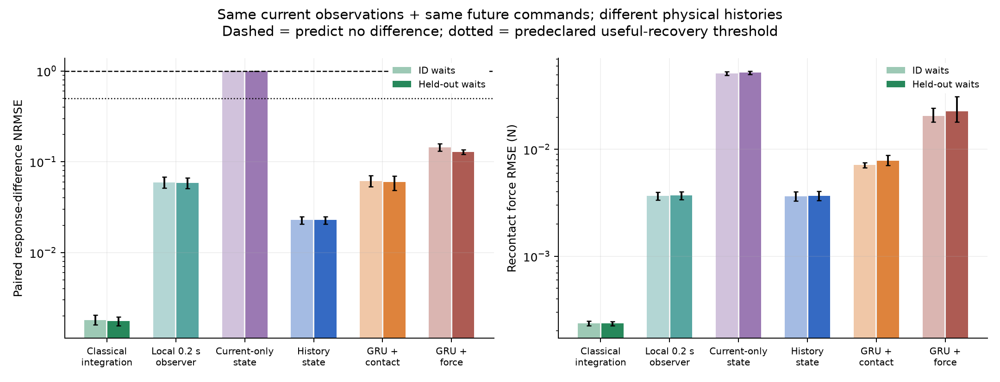
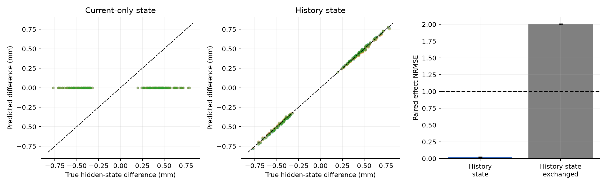
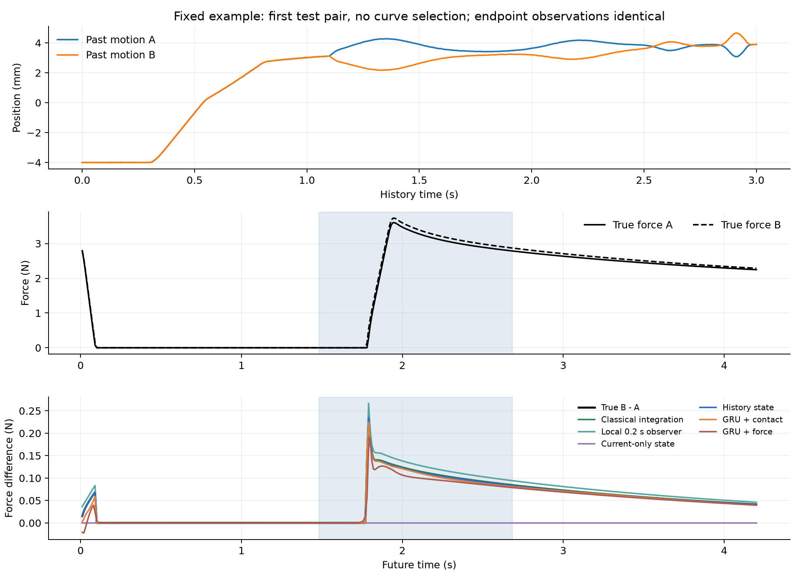
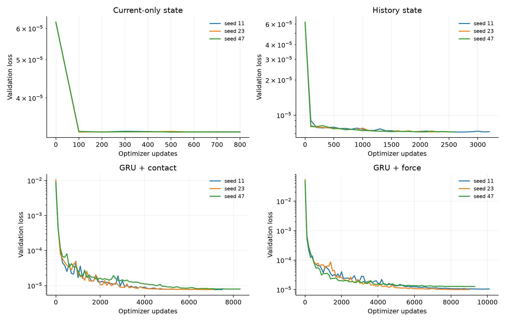

# 第二轮实验结论：历史状态能解决瞬时观测歧义，但学习的必要性仍要由真实材料决定

2026-10-19｜一维双模态 Maxwell｜全部模型完成验证平台期训练｜尚无实机数据

**本轮核心问题得到肯定回答：在固定物性的受控仿真域中，从历史接地的状态能够区分“当前读数相同”的两段物理历史，并预测跨脱离、恢复、重新接触后的不同响应。** 状态恢复和状态交换诊断也支持这一解释。

**研究决策同样明确：本域不支持神经学习的必要性，也不支持长历史必需。** 经典状态积分最准确；仅用最近 0.2 s 的线性观测器，绝对力误差已与历史神经模型相当。建议结束以已知 Maxwell 模型为核心的性能追逐，保留这套数据与诊断作为机制测试平台，接下来用少量实机数据选择真正未知的材料恢复机制。

## 核心设定与为什么它能回答问题

384 对训练历史、96 对验证历史、192 对独立测试历史。每对两条历史均从已恢复初态实际重放生成，切点位置、速度、力、命令相同；未来也施加相同命令。历史传感噪声独立，但切点使用共同噪声，使模型的当前输入严格相同。没有直接在切点替换真实状态，也没有按未来响应大小筛选样本。

模型使用 3 s 历史，预测未来 4.2 s，步长 0.01 s。训练等待 0.2–0.5 / 1.8–2.2 s；留出 0.8–1.2 s。它是同一材料上的等待区间插值，不是新材料或长时间外推。每组测试历史同时用于 ID 等待与留出等待，统计以独立历史对为单位。

物性仅从训练集的带噪位置与力辨识一次，然后冻结：

`k_inf=399.973 N/m, k=[898.880,1299.377] N/m, tau=[0.150536,1.400641] s`。

科学机制可以简化为：当前接触读数确定

\[
k_1z_1+k_2z_2=(k_\infty+k_1+k_2)x-F,
\]

但未确定两条支路之间的分配。两者具有不同松弛时间，后续响应因此不同。历史与当前编码器使用同一物理约束、同一正值分配参数化、同一接触／动力学解码器；区别只有是否读取完整历史。网络只用未来力／位移预测损失训练，没有真状态监督、配对差异损失或未来实际运动输入。

## 主要结果：预测的是响应差异，而不仅是平均曲线

主指标为配对力响应差异的 NRMSE：预测 `F_B-F_A` 的误差除以真实差异的 RMS，在再次压合命令开始后的 1.2 s 内计算。对两条历史作相同预测时指标为 1；0 为完全恢复。测试前约定的有用恢复标准为低于 0.5。

| 方法 | 留出等待：响应差异 NRMSE，95% 区间 | 绝对力 RMSE（N） | 隐藏状态差异 NRMSE |
|---|---:|---:|---:|
| 经典完整历史状态积分 | **0.00175 [0.00157,0.00196]** | **0.000234** | **0.00210** |
| 最近 0.2 s 的线性观测器 | 0.05866 [0.05096,0.06689] | 0.003695 | 0.03579 |
| 当前观测编码 + 固定材料模型 | 1.00000 [1,1] | 0.052179 | 1.00000 |
| **历史编码 + 固定材料模型** | **0.02282 [0.02067,0.02479]** | **0.003680** | **0.02177** |
| GRU + 已知接触结构 | 0.05974 [0.04861,0.06959] | 0.007793 | 未对其隐变量作物理坐标恢复主张 |
| GRU + 力输出 | 0.12778 [0.12088,0.13547] | 0.022624 | 同上 |

三种子与历史对的分层 bootstrap；经典方法只重采样历史对。这些区间不包含材料族、设备或真实世界变化。真实配对力差异的总体 RMS 为 0.10740 N，历史状态模型的差异预测 RMSE 为 0.002451 N。

当前观测模型并非仅仅没有训练好：给两条历史输出相同曲线时，对内平均真值达到的力误差下界为 **0.052094 N**；实际当前观测模型为 **0.052179 N**，已很接近。这是输入信息不足的直接证据。概率模型可以表达两种可能未来，但仅凭相同当前输入无法识别实际发生的是哪条历史。

历史状态模型在 ID 等待上的响应差异 NRMSE 为 0.02279，留出等待为 0.02282。由历史估计的状态没有随查询动作重新定义，而是在给定未来命令下继续演化。

## 状态恢复、交换与更简单的解释

隐藏状态诊断沿当前力观测的零空间方向，即与 `[k1,k2]` 正交的模态分配方向。历史模型对这项对内差异的 NRMSE 为 **0.02177**；当前模型为 1。两维状态的绝对 RMSE 分别为 **0.01104 mm** 和 **0.16615 mm**。这是已知、排序后的两个物理坐标内的恢复，不是任意潜空间的可辨识性结论。

将同一对中的历史估计状态 A/B 交换，保留相同的当前读数、未来命令及物性，响应差异 NRMSE 从 **0.02282** 升至 **2.00438**，接近把正确响应差异反向预测的结果。模型确实通过估计状态区分未来；这一干预建立在给定物理解码器上，不能被解释成网络自行发现了 Maxwell 定律。

两个 GRU 的编码器、未来命令递推器及参数量相同。接触版本预测等效接触参考位移，并通过已知刚度与单侧接触方程得到力；力版本直接输出正力，再通过同一执行器方程预测运动。接触版本的绝对力误差明显更低，但这是接触约束、已知瞬时刚度和输出参数化的共同效果，本轮没有再拆分这三者。**两个 GRU 都能恢复多数响应差异，不能据此声称普通 GRU 无法学习材料记忆。**

最近 0.2 s 的简单观测器没有学习参数，也不知道该短窗开始时的材料状态。它用过去位置／力与固定物性做线性最小二乘，然后推进到切点，已达到 0.003695 N 的力误差。这说明在此线性、已知接触段中，少量近期动态信息就足以消除主要歧义。历史神经模型的配对差异预测更准，绝对状态误差却略大于局部观测器的 0.00865 mm；不能笼统称其物理状态估计全面最优。

## 收敛、成本与数值边界

所有模型采用相同规则：至少 800 次更新，每 100 次检查验证集；连续 600 次更新没有至少 0.2% 的验证改善即停止，并在平台期降低学习率。验证最优权重用于测试。12 次训练最终全部达到此标准：当前模型各 800 次；历史模型 2,500–3,200 次；接触 GRU 7,100–8,300 次；力 GRU 9,000–10,100 次。这是预定优化协议下的平台期，不是全局最优证明。

原 8,000 次保护上限让 4 次运行未收敛；在查看任何模型测试表现前，保留原状态并延长上限、续训至同一标准。没有按测试结果重训或筛选种子。

5070 Ti 上所有训练、验证及权重保存累计 **981.9 s，约 16.4 min**。学习模型参数量为 3,777 或 7,809；最大 PyTorch 张量分配约 **146.5 MiB**，不含 CUDA 上下文及 CPU 数组。固定物理计算和解析导数在 CPU 上执行，GRU 在 GPU 上训练；墙钟时间不是 GPU 内核活跃时间。当前实验无需云算力。

物理／梯度／观测器检查及 CSV 接口检查合计 9 项通过。数值细化另有重要边界：对 8 个训练种子，在相同预测初态下将步长细化到 0.0025 s，响应差异相对 0.01 s 的平均离差约 0.00340 N，差异信号仍约 0.0972 N。重新在细步长构造匹配历史，差异机制仍存在。

但原离散命令原样细化重放后的端点力平均失配约 0.047 N。因此，“当前观测严格相同”是本离散评估集的性质；不能宣称原命令未经校准就能在连续系统或机器人上实现同样匹配。经典方法的极小误差也只表示同一模型／积分器内部的精度，不能解释为真实材料测量精度。

## 对后续研究的决定

**继续发展物理状态与未知材料机制这条主线，停止把这个线性域上的神经优越性当作主贡献。** 本轮已建立三项可靠能力：受控制造观测歧义；区分响应差异、平均预测和状态恢复；检验状态如何介导后续预测。经典积分及局部观测器必须继续保留。

我最推荐先检验的未知学习对象是：**压缩水平／加载历史依赖的恢复速率**。它直接影响脱离后再接触的后果，也能通过改变预加载、幅度与等待产生监督。先与更丰富的线性松弛谱、非线性静态刚度、控制器和同步误差比较；只有可重复的留出条件残差仍然存在，才考虑学习正值状态依赖时间尺度 `tau(e,z)`。这是一项待实测的候选机制，当前仿真没有证明真实软垫需要它。

下一步实机工作已具体化为 [24 条核心交互协议与机制判断表](实机衔接协议.md)：两种历史 × 两种幅度 × 三种等待 × 两次重复，另做校准及少量长恢复对照。先确认匹配质量和重复性，不直接训练一个实机神经模型。

轻量 [CSV 接入工具](real_data_intake.py) 已实现：列名映射、显式单位转换、时间单调性／间隔检查、缺失与非有限值拒绝、SI 数据输出及力—位移诊断。`examples/synthetic_demo.csv` 仅为软件测试，明确标注为合成数据；本轮没有实机结果。

复现入口见 [README](README.md)。`runs/round2_v1` 保存完整数据、固定物性、初始与续训记录、权重、逐对指标、预测、状态、数值审计及图表。主结果来自 `summary.json`，原始指标来自 `per_pair_metrics.csv`；本轮使用 physics-grounded-world-model 与 world-model-evaluation 的机制和证伪评估流程。
