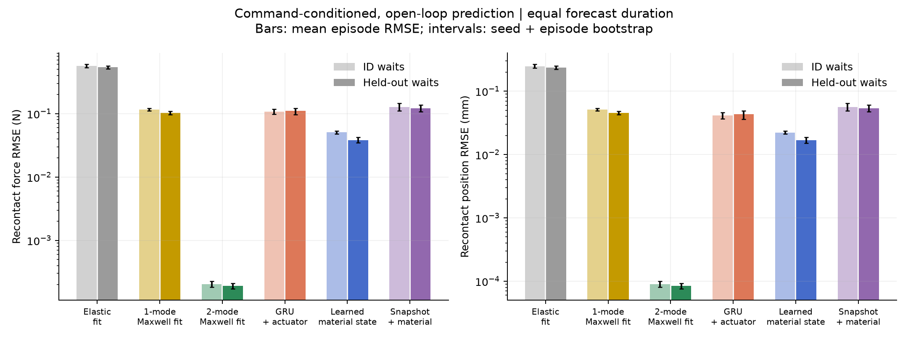
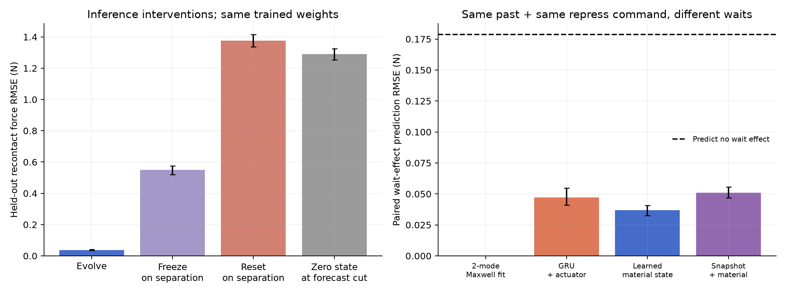

# 版本 B：一维材料状态首轮实验

2026-10-19｜本地 RTX 5070 Ti｜全部为仿真结果

**本轮得到有价值的正结果：历史接地的两维状态可以在脱离期间持续演化，并预测留出等待条件下的再次接触。但正确模型族的经典辨识明显更好；目前支持的是物理记忆机制及实验流程，不是神经学习的必要性或新材料泛化。**

## 做了什么

软垫采用双模态广义 Maxwell 模型，串接已知的一维阻抗执行器。真实时间常数为 0.15、1.4 s；接触由单侧互补约束决定。脱离后接触力为零，材料内部状态继续演化，自由表面逐渐恢复。实际压头运动由命令、执行器和材料共同决定，不把命令位移当作实际形变。

256 条训练交互、64 条验证交互、128 组配对测试历史；每条使用 3 s 历史预测未来 4.2 s，步长 0.02 s。训练等待为 0.2–0.5 或 1.8–2.2 s，测试留出 0.8–1.2 s。同一测试历史分别接训练范围内的等待和留出等待，其余再次压合动作参数相同。**这是等待区间的插值留出，不是长时间外推。**

历史输入为带噪的位移、速度、力、命令和时间步长；未来输入只有命令。未来实际力、位移仅作训练标签，模拟器内部状态不参与学习。主指标针对“再次压合命令开始后的 1.2 s”，避免大量零力等待稀释误差；仿真评价使用干净真值。所有样本从已恢复的初态开始。

经典模型分别拟合弹性、单模态和双模态参数，并由过去运动积分状态。学习模型包括 GRU 力响应模型、历史编码器接地两维状态的 Maxwell 模型，以及同容量、同物理解码器但只看当前观测的 Snapshot 对照。GRU 也接入同一已知执行器。三个学习模型各训练 3 个种子、330 次更新；只根据验证集选择权重。

## 关键结果

| 模型 | 留出等待：力 RMSE（N），95% bootstrap 区间 | 位移 RMSE（mm） | 训练范围内等待：力 RMSE（N） |
|---|---:|---:|---:|
| 弹性拟合 | 0.5385 [0.5080, 0.5711] | 0.23594 | 0.5643 |
| 单模态 Maxwell 拟合 | 0.1028 [0.0968, 0.1086] | 0.04539 | 0.1157 |
| **双模态 Maxwell 拟合** | **0.000190 [0.000171, 0.000209]** | **0.000084** | **0.000202** |
| GRU + 已知执行器 | 0.1109 [0.0963, 0.1221] | 0.04316 | 0.1083 |
| **历史接地材料状态** | **0.0382 [0.0346, 0.0421]** | **0.01676** | **0.0508** |
| 当前观测 + 同一材料模型 | 0.1215 [0.1070, 0.1371] | 0.05376 | 0.1270 |

区间同时重采样优化种子与独立测试历史；经典模型只重采样历史。这些区间不涵盖新材料、不同传感器或模型失配的不确定性。ID 与留出等待本身难度不同，不能因为后者误差略低就声称更难条件泛化更好。

**观测一：历史有用，但预测准确不等于辨识出真实物性。** 同样的物理解码器下，使用历史的模型优于 Snapshot；相对 GRU，主指标下降约 65.5%。然而学得的快速时间常数为 0.312–0.321 s，真值为 0.150 s；慢速时间常数为 1.507–1.531 s，真值为 1.400 s。经典辨识则得到 0.15007、1.39944 s。现有结果不能把网络潜状态解释为已恢复的真实内部状态；有限优化和当前激励都可能造成参数与初态相互补偿。

**观测二：无接触时的演化不能被简单删除。** 固定已训练权重，脱离时冻结状态，误差升至 0.549 N；脱离时清零，升至 1.376 N；在预测切点直接清零为 1.290 N。这些是推断干预，证明该模型依赖这项机制，不能代替重新训练后的竞争基线。

**观测三：模型确实预测了等待造成的变化，收益幅度比主指标更温和。** 将同一历史的两个未来按再次压合命令对齐，预测其力曲线差值：假设等待完全无影响的误差为 0.1786 N；GRU 为 0.0473 N；材料状态模型为 0.0371 N；Snapshot 为 0.0510 N。不能把主指标的 65.5% 改善直接解释成“等待效应预测提升 65.5%”。

另有独立机制诊断：构造并重放两段历史，使切点的位移、速度、力和命令相同，但内部模态分配不同；施加同一未来命令后，再接触力曲线最大逐时刻差异为 **0.113 N**。见 [诊断图](runs/pilot_v1/figures/05_matched_present_different_future.png)。这证明当前读数可能存在状态歧义；该历史对没有进入本轮训练或主测试，因此尚未证明网络能解决这种特定歧义。

## 可靠性、成本与边界

5 项物理与接口检查通过，覆盖互补约束、执行器力平衡、自由恢复、无输入时能量耗散、NumPy/PyTorch 一致性及未来标签接口。时间步长从 0.02 s 细化到 0.01 s 后，相对 0.005 s 参考解的力 RMSE 从 0.0116 降至 0.0043 N。**经典模型的极小误差是同一离散生成器内的预测精度，不代表真实材料的亚毫牛精度。** Oracle 约 8×10⁻⁸ N 的误差只是重放一致性检查。

| 本机实测 | 数值 |
|---|---:|
| 数据生成 | 0.49 s |
| 训练前测得更新成本：材料状态 / GRU，batch 32 | 0.351 / 0.221 s |
| 双模态经典辨识 | 约 0.41 s，8 次函数评估 |
| 每个种子：材料状态 / GRU / Snapshot | 107–111 / 84–86 / 107–109 s |
| 全部 9 次训练，含验证和权重保存 | **906 s，约 15.1 min** |
| 最大 PyTorch 已分配张量显存 | 约 **49 MiB** |
| 参数量：材料状态、Snapshot / GRU | 3,815 / 8,305 |

显存数值不含 CUDA 上下文、桌面和其他进程；时间不含环境安装与代码开发，不等同于 GPU 内核活跃时间。当前规模无需云算力。最初对两主模型测成本后确定 330 次更新；Snapshot 在任何测试评估前加入，沿用相同更新预算。

三个学习模型的最佳验证权重都在第 330 步，曲线仍在下降，**尚未完成收敛比较**。本轮没有调参搜索，也没有依据测试结果追加训练。GRU 没有材料模型的接触互补约束，示例中出现小幅无接触力；因此相对 GRU 的优势混合了本构、接触结构与历史表示收益。经典辨识与网络使用同一可用训练数据，但目标函数和利用历史标签的方式不同。

## 下一步最值得做什么

**优先把“相近当前观测、不同未来响应”的历史对扩成受控数据，再检验网络能否辨认；暂不扩大网络。** 这样直接针对状态学习的科学问题，而不是重复证明已知 Maxwell 结构可以工作。

下一轮建议先将物性固定为训练集经典辨识值，只比较历史编码与当前观测编码，避免参数—状态补偿；同时按预先规定的验证收敛标准训练，并加入有接触约束的 GRU 比较，接触门控只能依据自身预测，不能读取未来真实接触标签。记录历史匹配误差、内部状态诊断和共同未来的响应差异。若差异消失，收缩“历史表征学习”的主张；若差异保留且历史模型可恢复，才进入非线性或材料族变化，检验学习超越固定经典模型的空间。本轮不据此启动下一轮训练。

实机先用 [少量采集协议](实机采集协议.md)：3 次校准，2 种预加载 × 3 种等待 × 3 次重复，共 18 条核心交互，另可加 6 条对照。先验证恢复时间尺度和历史效应是否高于噪声，再决定扩采。软垫是验证载体；论文主张应落在跨接触条件的可预测材料状态。

复现入口、完整方程和文件说明见 [README](README.md)。数据、9 个最佳权重、日志、5 张图、逐轨迹指标和环境记录全部位于 `runs/pilot_v1`；指标来源为 `summary.json`、`wait_effect.json`、`learned_parameters.json`，成本来源为 `cost_summary.json`。本轮使用 physics-grounded-world-model、world-model-evaluation 与 paper-novelty-design-v1 的机制拆分、评估契约和主张边界要求。
