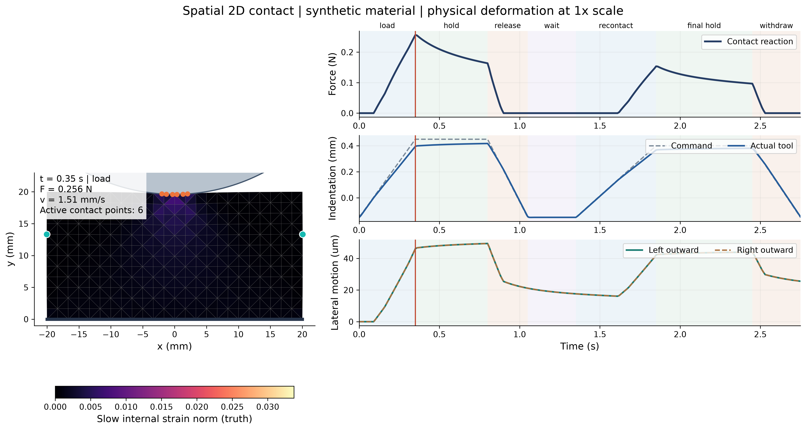

# Spatial 2D hidden-state experiment

**[Open the interactive notebook](spatial_2d_hidden_state.ipynb).** Run it in the repository's VS Code Dev Container with `/opt/venv/bin/python`.

A circular rigid indenter loads a fixed-bottom, free-sided body, holds, releases, waits and makes contact again. Triangle FEM solves the deformation and contact reaction. Two internal-strain fields carry fast and slow relaxation; their time constants are 0.12 s and 0.9 s.



## Walkthrough

1. **Physical process:** play the mesh and force/displacement curves with a shared time cursor.
2. **Different histories:** compare current motion, force and lateral-marker residuals with internal-state diagnostics.
3. **Future actions:** reuse a physical checkpoint for slow press, fast press, hold or release; compare four state estimates.
4. **History length:** inspect prediction error under different windows, noise and excitation.

The timeline replays results. Changing an action or noise level takes effect when **Run** is pressed; **Recompute** requests a new solve.

## Recorded pilot

Mean future-force RMSE in mN, across eight independent test histories:

| Future command | Noise | Instantaneous fit | Short classical, 0.2 s | Full-history replay |
| --- | --- | ---: | ---: | ---: |
| Slow press | None | 1.319 | 1.101 | <0.001 |
| Slow press | Nominal | 1.660 | 2.377 | 0.008 |
| Fast press | None | 1.575 | 0.923 | <0.001 |
| Fast press | Nominal | 1.966 | 2.332 | 0.009 |

Source: [`summary.json`](../runs/2d_contact/pilot_c9dd23016896/summary.json). Full replay knows the relaxed initial state and correct model. True-state forecasts use privileged internal fields for the same future command. Each condition uses one noise realization; this is a pilot comparison.

All 17 main physical checks pass. The retained failures include an initial coarse-mesh discrepancy and a validation history with 5.0247 um penetration against a 5 um limit. See [physical scope and results](../docs/spatial_2d/README.md#results-and-scope) and the [raw pilot](../runs/2d_contact/pilot_c9dd23016896/RESULTS.md).

## Code, data and commands

- [Implementation](../src/nr2d/): one solver and estimator implementation shared by notebook and CLI.
- [Recorded data](../runs/2d_contact/pilot_c9dd23016896/): histories, future branches, sweeps, checks, figures and source snapshots.
- [Container guide](../docs/spatial_2d/CONTAINER.md): build, kernel selection and validation.
- [Presentation notes](../docs/spatial_2d/DEMO.zh-CN.md): three-minute explanation in Chinese.

From the repository root inside the container:

```sh
python tools/validate_container.py
python -m nr2d.cli demo --recompute
python -m nr2d.cli batch --actions "Slow press" "Fast press" --noises 0 1
python -m nr2d.cli export
```

The next experiment is calibration-only noise weighting followed by new histories with independent noise, varied waits and parameter mismatch. The broader [2D protocol](../plans/2d_contact/README.md) and [3D robot plan](../plans/robot_manipulation/README.md) remain separate from these completed results.
