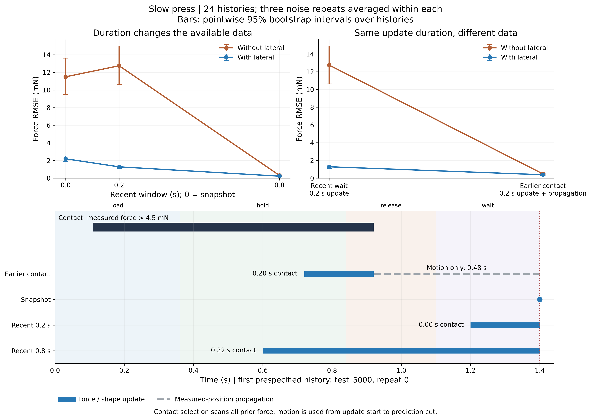
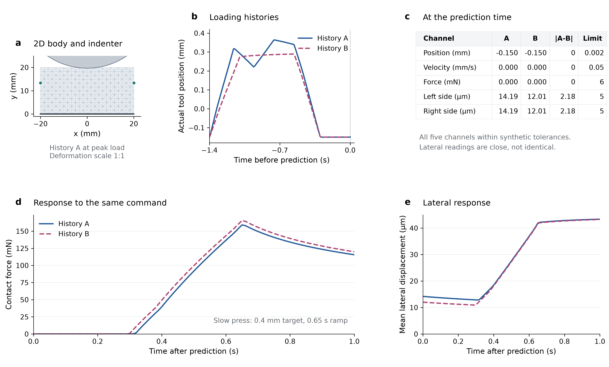
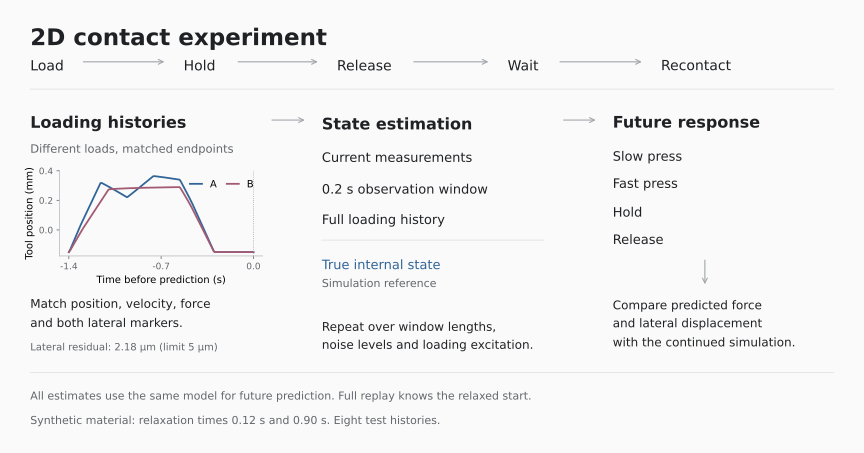

# Spatial contact and hidden state

[Repository](../README.md) · [Run](#run) · [Results](#results) · [Experiment design](#experiment-design) · [Related reading](#related-reading) · [Files](#files)

A circular indenter loads a viscoelastic body, releases it and makes contact again. We test how much current lateral shape reveals about its state, and what contact and recovery history add to future-response prediction.

## Run

1. Open the repository in VS Code and choose **Dev Containers: Reopen in Container**.
2. Open [spatial_2d_hidden_state.ipynb](notebooks/spatial_2d_hidden_state.ipynb).
3. Select the container's **Python 3.11.9** and **Run All**.

Run All computes one fresh spatial trajectory and replays recorded comparisons. Sliders control playback; Run and Recompute buttons control calculation. New observer comparisons are stored separately from the published results.

[Docker setup](docs/CONTAINER.md) · [Parameters](docs/CONFIGURATION.md) · [Batch commands](tools/README.md) · [Report 10.2](../research/presentations/10.2/README.md)

## Results

### Sensor channels and contact history

The [new comparison](runs/information/channels_contact_20261026/RESULTS.md) uses 24 independent histories and three noise draws per history. For Slow press, current lateral shape reduces mean force error from 11.50 to 2.20 mN; recent lateral history reduces it to 1.29 mN over 0.2 s and 0.23 mN over 0.8 s. The same estimates also predict Fast press.

Waiting contains useful recovery information when lateral sensing is enabled. Without it, earlier contact plus motion propagation is much more informative. [Section 5 of the Notebook](notebooks/spatial_2d_hidden_state.ipynb) provides sensor, window and future-action controls. The original pilot below is retained; its noisy-short-window loss does not generalize to the new batch.

### Pilot results

Start with [the recorded pilot](runs/2d_contact/pilot_c9dd23016896/RESULTS.md). It contains eight independent test histories, the force-error comparison and the retained penetration-limit failure.

The recorded pair has identical endpoint tool position, velocity and contact force. The lateral-marker residual is 2.18 um against a 5 um matching tolerance. The same slow-press command produces a maximum force difference of 9.65 mN in simulation. Geometry is displayed at 1:1 deformation scale; the response axes include zero.

The pair was selected from current measurements before computing the future response. All five current channels are shown. The remaining lateral difference can still provide instantaneous information; this pair alone does not establish that history is necessary. [Source data](docs/figures/hidden_state_pair.csv) · [Conditions and provenance](docs/figures/hidden_state_pair.json) · [SVG](docs/figures/hidden_state_pair.svg) · [PDF](docs/figures/hidden_state_pair.pdf).

Short history helps in noiseless prediction and degrades under nominal noise. Full replay benefits from known parameters and a relaxed initial state. This pilot does not compare controllers.

## Experiment design

The material, geometry, contact and future solver stay fixed. Channel masks and observation windows change what the estimator can use. This separates sensing and history effects from changes to the physical model. Full replay additionally knows the relaxed initial state; the true-state reference receives the internal fields.

[Design and comparison conditions](docs/DESIGN.md) · [Physical model and estimators](docs/README.md)

## Related reading

These papers connect the current force/shape experiment to predictive state, robot interaction history and material memory. Paper IDs match the detailed research audits.

| Reference | Connection to this experiment |
| --- | --- |
| **T03 — Predictive Representations of State.** Littman, Sutton and Singh, NIPS 2001. [Paper](https://proceedings.neurips.cc/paper/2001/file/1e4d36177d71bbb3558e43af9577d70e-Paper.pdf). | Defines state through predictions of future action–observation tests. This motivates evaluating a representation by the future interactions it predicts, without requiring recovery of unique physical coordinates. The paper's discrete formulation does not establish sufficiency of our finite observation windows. |
| **P01 — RoboPack: Learning Tactile-Informed Dynamics Models for Dense Packing.** Ai et al., RSS 2024. [Paper](https://www.roboticsproceedings.org/rss20/p130.html). | Infers object geometry and latent physical information from vision and touch, then predicts dynamics for MPC. A close precedent for the estimation–prediction–control chain, with richer tactile and point-cloud observations than our force and lateral-shape channels. |
| **P16 — HIRE: History-Conditioned Interaction Reasoning and High-Rate Execution for Visually Aliased Precision Manipulation.** Li et al., arXiv preprint, v1, 2026. [Paper](https://arxiv.org/abs/2609.30828v1). | Uses ordered wrench history and contact feedback to resolve ambiguous interaction progress on real robots. Directly relevant to the claim that history can change the appropriate action; its task/contact representation differs from the internal relaxation variables examined here. |
| **P03 — Rapid Mismatch Estimation via Neural Network Informed Variational Inference.** Jaszczuk and Figueroa, CoRL 2025. [Paper](https://proceedings.mlr.press/v305/jaszczuk25a.html). | Combines a learned prior with variational inference to estimate payload mass and center of mass from proprioception, including uncertainty. A useful reference for short-window estimation and robot integration. These are unknown payload parameters, distinct from evolving internal material state. |
| **P02 — AdaptiGraph: Material-Adaptive Graph-Based Neural Dynamics for Robotic Manipulation.** Zhang et al., RSS 2024. [Paper](https://arxiv.org/abs/2407.07889). | Adapts material properties from interactions for particle-graph prediction and MPC. It also uses recent particle positions, so it is not a memoryless baseline. It helps separate unknown-property adaptation from our experiment, which holds material parameters fixed while histories change internal state. |
| **P04 — Viscoelasticty with physics-augmented neural networks: model formulation and training methods without prescribed internal variables.** Rosenkranz et al., Computational Mechanics 74, 1279–1301, 2024. [Published paper](https://doi.org/10.1007/s00466-024-02477-1) · [Full text](https://arxiv.org/html/2401.14270v1). | Learns constitutive evolution from strain/stress paths without supplied internal-variable trajectories. This is a direct precedent for material memory and its evolution. Our inference problem uses sparse boundary force and lateral shape, rather than material-point strain/stress measurements. |

History encoding and material internal variables are established ideas. Our current experiment isolates what lateral sensing and contact/recovery history add to prediction with the physical model and future actions held fixed. Whether this improves robot decisions remains open.

The [method audit](../research/hidden_state_reframing/closest_work.md) records observations, supervision, hardware, code and reproduction limits for P01–P04 and P16. The [state formulation](../research/hidden_state_reframing/formalization.md) covers the theory and connects it to the current model. These are literature comparisons, not reproduced external baselines.

## Files

| Location | Contents |
| --- | --- |
| [notebooks/](notebooks/) | Interactive experiment and cached-result controls |
| [src/nr2d/](src/nr2d/) | Solver, estimators, experiment functions and plots |
| [configs/](configs/) | Physical parameters and observer settings |
| [environment/](environment/) | Docker image and pinned dependencies |
| [tests/](tests/) | Physical, information-use and configuration regressions |
| [tools/](tools/README.md) | Execution, figure export and validation commands |
| [docs/](docs/README.md) | Model, design, setup and configuration details |
| [runs/](runs/README.md) | Results, raw data, figures and execution records |
