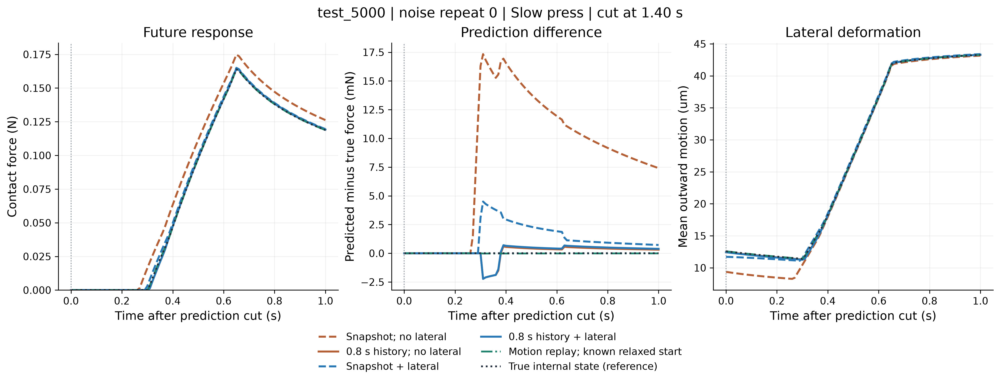
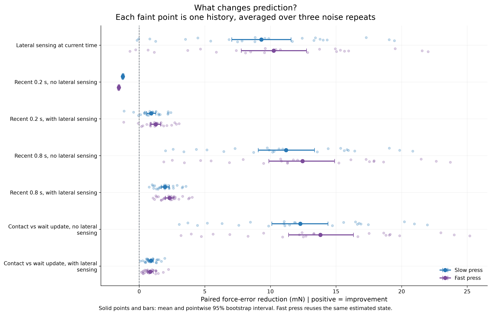

# Sensor channels and contact history

Current lateral shape supplies substantial predictive information. History adds information beyond it, including during detached recovery. Contact-containing history is especially useful when lateral sensing is unavailable.

## Recorded comparison

24 independent loading histories, three independent nominal-noise draws each. Every method receives the same draw and predicts at 1.40 s. Material, geometry, FEM, contact, commands and future solver are unchanged. Three separate calibration histories selected one shared preset from three candidates; the original preset had the lowest calibration error. Test data and Fast press were excluded from selection.

The table reports force RMSE in mN, averaged within history and then across histories. Each estimate is reused for both future actions. These are predictions, not closed-loop control results.

| Information used | Slow press | Fast press |
|---|---:|---:|
| Current position, velocity, force | 11.504 | 12.764 |
| Current channels + lateral shape | 2.198 | 2.516 |
| Recent 0.2 s, without lateral | 12.753 | 14.323 |
| Recent 0.2 s, with lateral | 1.286 | 1.256 |
| Recent 0.8 s, without lateral | 0.314 | 0.317 |
| Recent 0.8 s, with lateral | 0.230 | 0.207 |
| Earlier contact update + propagation, without lateral | 0.476 | 0.514 |
| Earlier contact update + propagation, with lateral | 0.389 | 0.415 |
| Full measured-motion replay; known relaxed start | 0.0065 | 0.0075 |
| True internal fields; same forward solver | 0 | 0 |

The two references have privileged information. Zero reference error follows from using the same simulated state and model; it is not an optimal-control bound.

## Three views of the result



The example is the first prespecified history, `test_5000`, noise draw 0. It was not selected by future error. The Notebook switches channels, window, history, noise draw and future action. Individual draws can differ from the batch trend.


The recent 0.2 s window is entirely waiting. The 0.8 s window contains hold, release and wait, with 0.31-0.34 s of measured contact. Earlier-contact updates cover 0.20 s, ending at 0.91-0.94 s; measured position then propagates the estimate for another 0.46-0.49 s. The total motion span is 0.66-0.69 s, and contact selection scans all prior force. This is not a method using only 0.2 s of total history. Exact phases and intervals are in [coverage.json](coverage.json).



For Slow press, adding current lateral shape reduces error by **9.31 mN**, with a history-bootstrap 95% interval of **[7.06, 11.57]**. Adding recent 0.2 s lateral history to that snapshot gives **0.91 [0.57, 1.27] mN**; using 0.8 s gives **1.97 [1.68, 2.30] mN**. Earlier contact plus propagation improves on the recent lateral wait by **0.90 [0.72, 1.08] mN**. These are exploratory, pointwise intervals from 2,000 resamples of 24 complete histories. Noise repeats and future branches do not increase the independent sample count.

## Interpretation

- **Lateral shape:** it exposes recovery while total contact force is zero. The symmetric specimen's two markers measure the same underlying lateral mode with independent noise. Snapshot shape is useful, but the remaining history gain does not support treating it as sufficient for these predictions. This also does not prove every possible instantaneous estimator would fail.
- **History:** the recent lateral wait improves prediction even without contact. Temporal recovery and averaging noisy measurements can both contribute; this experiment does not separate those mechanisms. The old eight-history pilot's noisy-short-window loss remains recorded, but does not generalize to this independent batch. The selected observer preset did not change.
- **Contact versus duration:** without lateral sensing, waiting gives no informative force response. All 72 snapshot and all 72 recent-wait fits retain their initial coefficients. Their error difference includes prior placement and propagation, not evidence that history itself is harmful. Earlier contact plus measured-motion propagation is much more informative. Its longer input span prevents attributing the entire gain solely to contact content. A 0.8 s window provides more useful data here; length alone is not the explanation.
- **Classical-method gap:** the current six-coefficient, nonnegative point estimate is fitted from scratch. It does not report state uncertainty. 201 of 576 finite-window fits reached the seven-evaluation cap, including 70/72 lateral-contact fits. Median inference time during the eight-worker batch was 0.15 s for the lateral snapshot, 3.21 s for its 0.2 s window, 27.24 s for its 0.8 s window, and 12.29 s for its contact update. These are not real-time observers. A larger calibration budget reduced nonconvergence but did not improve the shared mean score; optimization status alone is not prediction quality.

Four prespecified histories also ran without noise as a diagnostic. Their Slow-press lateral errors were 1.14 mN (snapshot), 1.07 (0.2 s), 0.03 (0.8 s) and 0.07 (contact + propagation). This smaller subset is not substituted for the primary 24-history comparison.

## Scope and checks

No computation exceptions occurred. One test history (`test_5017`) reached 5.030 um penalty penetration against the 5 um limit; one calibration history reached 5.015 um. Both were retained. Force balance and strain stayed within the recorded limits. [Failures](failures.json) includes physical overruns and optimizer counts. The physical model and its existing refinement checks were reused, not newly validated on real material. Sub-mN estimator differences are within-model evidence, not a claim of sub-mN physical fidelity.

Ten regression tests passed, including disabled-channel mutation and propagation-only input isolation. Seven [data-contract checks](verification/data_contract.json) passed: independent seeds, exact observation replay, matching masks, unchanged physics and identical estimated-state hashes across actions. [Notebook execution](verification/notebook.json) passed from a fresh Docker kernel in 7.61 s. [Callback checks](verification/callbacks.json) cover playback, channel/window/action changes and one fresh recomputation.

CPU timings: initial calibration-history preparation 28.13 s; measured two-action trial 59.99 s; calibration 227.62 s; test generation, 72 noisy jobs and four noiseless jobs 965.85 s with eight workers. The container bind-mount stores all results in this project.

## Next experiment

Carry a contact-informed estimate through release and wait with a warm-started classical recursive observer. Compare its accuracy, update cost and uncertainty with the present window fits at several prediction cuts, using new calibration/test histories. First test whether an observation update is informative; do not repeatedly refit an unobservable wait. Include a noise-free and repeated-observation control to separate recovery information from denoising.

Then compare snapshot, recursive observer and true-state reference under the same feedback controller. Proceed only if the true-state reference offers a meaningful task benefit under the available actions and feedback delay. These results justify studying information-aware state updates; they do not yet justify a neural representation, JEPA, or a claim of decision sufficiency.

## Reproduce

From `2D/` in the existing Dev Container:

```sh
python -m nr2d.information prepare
python -m nr2d.information timing
python -m nr2d.information calibrate --workers 4
python -m nr2d.information evaluate --workers 8
python -m nr2d.information summarize
python -m nr2d.information verify
python -m nr2d.information figures
```

Existing jobs replay their cache. For a fresh run, copy [the study configuration](../../../configs/information_study.json), change `run`, and pass `--config` to every stage. Raw physical histories are in `histories/`; each `test/<history>/repeat_<n>/` contains observations and curves, internal-state estimates and per-method metrics. `calibration/` retains every candidate, including unsuccessful optimizations. SVG, PDF and 300 dpi PNG versions share each figure stem and provenance record.
