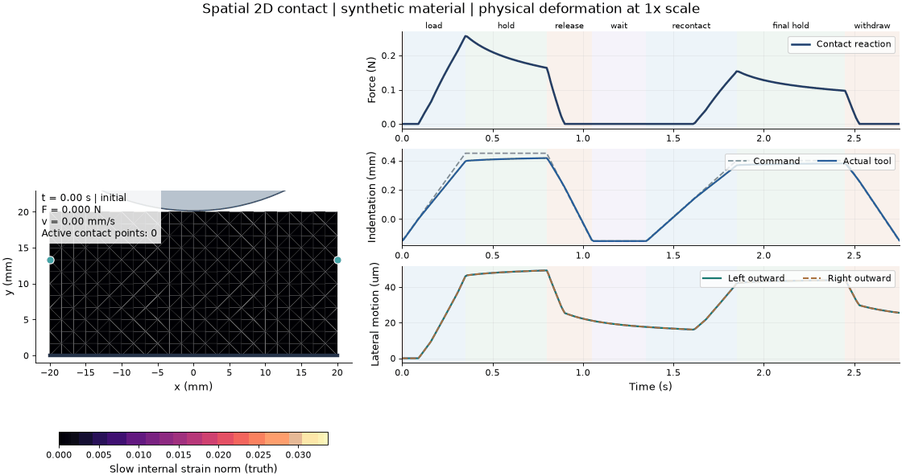

# NR · Object hidden state

How much interaction history does a robot need to predict an object's next response? This project studies hidden dynamic state through materials with fast and slow relaxation.

**Start with [2D](2D/README.md)** — a spatial FEM experiment with a circular indenter, solved lateral deformation, classical state estimates and an interactive VS Code notebook.

## Run the 2D demo

1. Clone this repository and open its root in VS Code.
2. Start Docker Desktop with the Linux engine and choose **Dev Containers: Reopen in Container**.
3. Open [`2D/spatial_2d_hidden_state.ipynb`](2D/spatial_2d_hidden_state.ipynb), select `/opt/venv/bin/python`, then **Run All**.

The demo computes a fresh main trajectory and replays saved prediction comparisons. **Recompute** runs a selected comparison again. The Linux notebook has been executed from a clean kernel; native playback, sliders and curve updates were also checked in VS Code.

[Build and CLI commands](docs/spatial_2d/CONTAINER.md) · [Model and results](docs/spatial_2d/README.md) · [Three-minute demo / 中文讲解](docs/spatial_2d/DEMO.zh-CN.md)

## Research status

| Study | Evidence | Status |
| --- | --- | --- |
| [Spatial 2D](2D/README.md) | 17 physical checks; eight test histories; cross-action predictions and history-window sweeps | Executed pilot |
| [Archived 1D E1/E2/E3](early%20experiment/RESULTS.md) | History-dependent response, controller transfer and common-feedback control | Executed; E3 found no action benefit |
| [Hidden-state formulation](plans/hidden_state_reframing/README.md) | State definitions, two-framework mapping, literature audit and discriminating experiments | Research design |
| [3D robot manipulation](plans/robot_manipulation/README.md) | Coupled robot/contact requirements and staged protocol | Planned |

The 2D pilot uses synthetic, small-strain material parameters. A short classical observer helps without noise but is less accurate than the instantaneous fit under nominal noise. Full-history replay performs well with its known relaxed start and correct model. These results motivate testing noise, excitation and model mismatch before adding learned representations.

## Repository map

| Path | Contents |
| --- | --- |
| [`2D/`](2D/) | Main notebook and experiment overview |
| [`src/nr2d/`](src/nr2d/) | Physics, protocols, estimators, plots, widgets and CLI |
| [`tests/`](tests/) | Numerical and data contracts |
| [`tools/`](tools/README.md) | Notebook execution, validation and environment helpers |
| [`runs/`](runs/README.md) | Published raw data, figures, failures and reproducibility records |
| [`docs/`](docs/README.md) | Setup, implementation and presentation guides |
| [`plans/`](plans/README.md) | Literature, research decisions and future protocols |
| [`early experiment/`](early%20experiment/README.md) | Preserved 1D code, data, trained models and slides |
| `.devcontainer/`, `Dockerfile`, `requirements-container.*` | Pinned Linux CPU environment |

Each result stays with its configuration and provenance. Routine notebook replays, editor state and local environments stay outside Git; the published pilot includes the raw trajectories behind its figures. See the [run index](runs/README.md).

For the archived 1D environment, use [SETUP.md](SETUP.md) or [中文安装说明](docs/SETUP.zh-CN.md). Its CUDA training dependencies are separate from the current CPU container.
