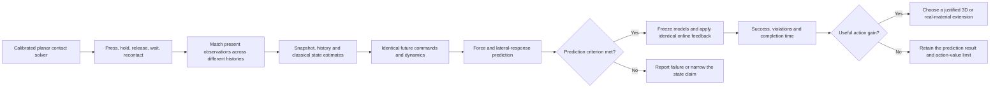

# Original 2D contact protocol

Proposed October 23, 2026. This page retains the original plan. The spatial solver, classical estimators, interactive pilot and subsequent 24-history sensor/contact study have now been run; their actual scope and results are in the [2D overview](../../2D/README.md). The larger sample counts, learned models, decision experiment and real calibration below remain proposals. Earlier experiments are in [1D/](../../1D/README.md).

The next study uses a single indenter and a deformable body in a plane. It should show how previous loading changes force and sideways deformation during the next contact, then test whether that information affects a decision under shared feedback.

## The question

For a single indenter contacting a deformable body in a two-dimensional spatial domain, can prior interaction history improve the prediction of the next contact, and does that improvement change actions when every method receives the same online feedback?

Start by validating the contact simulation and a classical observer. The current pair of scalar Maxwell states may be too small to represent the spatial state of the body; that representation needs its own check before comparing learned estimators.

## Physical setup

- Use one rectangular body in a 2D plane-strain simulation, a fixed lower boundary, free side boundaries, and a single rigid rounded indenter. Begin with frictionless normal contact, gravity compensation and a known impedance actuator.
- Run the sequence **press, hold, release, wait, recontact**. Only normal indenter motion is actuated in the first experiment; the body can deform in both spatial directions. Two lateral surface markers make the sideways response observable.
- Start with an elastic reference and a generalized-Maxwell viscoelastic body, using declared synthetic parameters. Hold geometry and contact law fixed when comparing materials. Do not fit material values from the conceptual gel figure.
- Work at amplitudes that pass a small-strain validity check. Select geometry, strain range, force/deformation limits, mesh and integration step using calibration/validation cases before freezing the test. If local strains invalidate the approximation, reduce the amplitude or explicitly adopt a finite-deformation formulation before collecting confirmatory results.
- Produce an animation with the actual mesh, indenter, normal force and lateral marker displacements. Display the nominal prediction and observed/simulated response on the same axes. The animation must come from the solver.

The generalized-Maxwell internal-variable construction and compatible strain/stress formulations have an existing implementation reference in the [MOOSE documentation](https://mooseframework.inl.gov/source/materials/GeneralizedMaxwellModel.html). The final solver choice is pending the numerical feasibility check; this release does not claim that MOOSE has been integrated.

## State, observation and action

| Quantity | Definition | Availability |
| --- | --- | --- |
| Physical state | Displacement/velocity field and viscoelastic internal variables | Simulator only; privileged diagnostics |
| Standard observation | Indenter position and velocity, normal force, applied command and time increment | Every deployable estimator |
| Surface observation | Lateral displacement of two marked surface points | Shared by all methods in an explicitly separate sensor condition |
| History | The preceding three seconds of the selected observation channels and commands | History methods; never future labels |
| Future action | Declared command trajectory, known controller gains and intervention timing | All prediction methods |
| Context | Geometry, contact law and material parameters for the primary fixed-material test | Shared and recorded; parameter-unknown tests are separate |

The reduced material-state representation is selected on training/validation data only. Test whether two components are sufficient before assuming the old representation transfers. Any increased state dimension must be shared by the history and snapshot comparisons and included in the compute report.

## Define mismatch before measuring it

For a prediction made at time t under a specified future action:

`force_residual(t+k) = measured_force(t+k) - predicted_force(t+k)`

`lateral_residual(t+k) = measured_marker_displacement(t+k) - predicted_marker_displacement(t+k)`

Keep three causes separate:

| Test | What changes | What remains fixed | Interpretation |
| --- | --- | --- | --- |
| A: state/history mismatch | Past loading and recovery | Material, geometry, current measured readings and future action | Tests whether the present observation aliases different physical memories |
| B: parameter mismatch | Material stiffness or relaxation parameters | State-estimation protocol and controller | Tests adaptation to changed parameters; not evidence about state inference alone |
| C: structural mismatch | A 1D nominal law versus a spatially resolved 2D plant | Matched observations and action | Diagnoses missing spatial physics; does not isolate a learned-state contribution |

**A is the primary next experiment.** B and C are diagnostic extensions reported separately. A force residual alone must not be described as identifying its physical cause.

## Experimental sequence

### 1. Check the contact model and history effect

Verify contact complementarity, actuator balance, zero tensile contact force, recovery during separation and passive energy behavior in a suitable no-input case. Refine mesh and time step independently. Require the change in the primary force metric to be below 5% and smaller than the intended method effect before model comparisons.

Use calibration histories to establish that prior loading changes the later force/lateral response above the measurement-noise floor. Match the entire observation set used by a method at the prediction cut. If lateral markers reveal the difference immediately, call that observable shape information rather than hidden memory.

Do not select test pairs by their future force difference. If the preregistered test set has a near-zero effect signal, report the claim as unidentifiable in that regime rather than discarding pairs or searching for more favorable examples.

### 2. Predict from matched observations

Start with 384 training pairs, 96 validation pairs and 128 test pairs. The members of a pair have different replayed histories, matched present observations and an identical future command. These counts are proposed budgets; use a calibration-only cost/noise study to finalize them before test generation.

Assign complete history pairs, all derived action branches and their random seeds to one split. Use independent seed ranges for train, validation and test. Initially keep one geometry and material, with held-out wait intervals and future command speeds. Report within-range interpolation and out-of-range transfer separately.

Compare:

1. A nominal snapshot predictor using the same fixed spatial/reduced dynamics.
2. The history state estimator with the same dynamics, state dimension and parameter count.
3. A calibrated classical state observer using the same measured channels; include both short-window and full-history variants when feasible.
4. A direct recurrent response predictor with a comparable parameter and tuning budget.
5. A privileged true-state rollout to measure the numerical/model ceiling.

The primary metric is paired force-effect NRMSE in the first 1.2 seconds after the commanded recontact begins. Report force RMSE in N and lateral displacement RMSE in mm as supporting metrics. The contrast denominator is the aggregate true paired response RMS over the declared test population. A predictor that gives both pair members the same response scores 1 when the signal is nonzero.

Predeclare useful recovery as paired-effect NRMSE below 0.5 and at least a 20% reduction relative to the matched snapshot predictor, with a pair-level 95% interval supporting the improvement. Report classical comparisons even if they win. Improvement over snapshot alone is not evidence that a neural model is needed.

### 3. Test actions under shared feedback

After the prediction comparison meets its criterion, freeze predictors and compare an identical action catalogue, observer, control rate, feedback channels, force limit and rejection rule. Every initialization receives the same feedback. Include a classical observer and a reactive controller as strong references, documenting any action-space difference.

Evaluate zero additional delay plus declared 20, 50 and 100 ms latency conditions. These are proposed stress conditions, not measured robot latency. Report all conditions; do not retain only the delay where history helps. For later hardware tests, declare the primary latency from the measured sensing/control chain.

The action endpoint is successful target attainment without a force or deformation-limit violation over the **entire episode**, including release and post-goal overshoot. Count rejection, timeout and violation as failures and report each separately. Predeclare a useful gain as at least 5 percentage points in success at the declared primary condition, with no increase in violation rate; report intervals and completion-time tradeoffs.

If common feedback removes the advantage again, retain the negative result and restrict the claim to prediction/initialization. Do not replace this endpoint with a favorable open-loop metric after testing. Force/deformation violations are engineering proxies and do not establish fracture or crushing of a real material.

## Statistics, budget and stopping rules

Use optimization seeds 11, 23, 47, 71 and 101 for learned models. Resample independent history pairs as clusters, keeping their action/controller branches together, and include the optimization-seed variation. Report 95% intervals, individual seeds and all failed runs. Controller ticks and two members of a pair are not independent samples.

Measure solver and training costs on calibration data. A proposed ceiling is 8 CPU-hours for the initial solver feasibility study and 24 GPU-hours for all learned-model development, with at most three validation-only tuning trials per learned method. These are maximum planning budgets, not executed compute or automatic authorization to start a training job.

Freeze a versioned configuration, split seeds, numerical tolerances, sensor noise, state dimension, calibration-derived limits, metrics and tuning budgets before confirmatory test generation. The companion `eval.json` is a structurally complete draft contract, not a claim that these calibration decisions have already been made.

## What to carry forward

Keep the solver checks, an animation of loading and lateral deformation, the prediction comparison, and the common-feedback action results together. Advance to 3D only when the 2D result identifies a reproducible phenomenon that 3D geometry or contact would meaningfully test.

The [RME paper](https://proceedings.mlr.press/v305/jaszczuk25a.html) estimates changing end-effector load parameters from proprioception. A material-state adaptation is a separate planned baseline and must be implemented and validated before it is labelled as an RME comparison.

